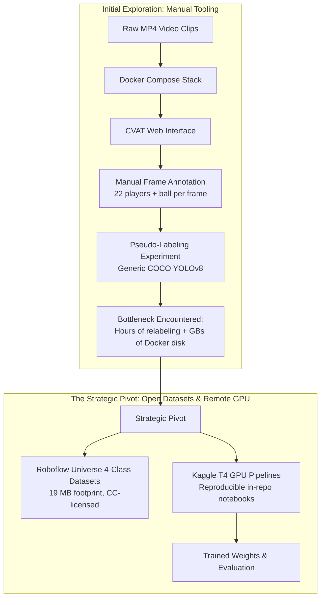
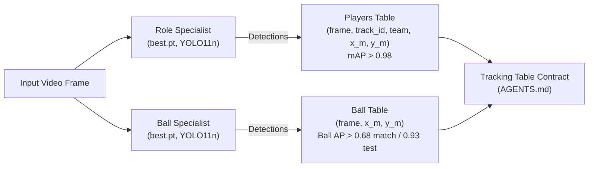

# Phase 2 — Computer Vision & Object Detection: Complete Summary

This document provides a comprehensive, standalone record of **Phase 2 (Detection)** of the `sports-graph` project. It is written so that anyone joining the project can immediately understand what was built, why architectural decisions were made, how tools (including Docker and CVAT) were used or evolved, what data sources were integrated, and how the models and benchmarks perform.

---

## 1. Executive Summary & Objective

- **Mission**: Transition the project from synthetic tracking data to computer vision by extracting raw soccer video frames and training deep learning detectors to identify game entities in real time.
- **The 4 Target Classes**: `player`, `goalkeeper`, `referee`, `ball`.
- **Primary Benchmark Target**: Exceed **0.85 macro mAP** (Mean Average Precision) on genuinely unseen, held-out match footage.
- **Strict Operating Constraints**:
  - **Local Storage**: Strict limit of **<100 MB** total disk footprint for data and models inside the repository.
  - **No Paid APIs**: Rely strictly on open-source weights, free datasets, and free compute tiers.
  - **Local Compute**: The local machine has **CPU only** (`torch.cuda.is_available() == False`). Heavy neural network training is offloaded to free cloud GPUs (Kaggle T4), while testing, manifests, and evaluation pipelines run locally.
  - **Strict Architecture Boundaries**: Vision (`detection/`, `vision/`) and Analytics (`analytics/`) communicate **exclusively** through the standardized Tracking Table contract (`frame, track_id, team, x_m, y_m`). Neither imports the other.

---

## 2. The Tooling & Annotation Journey (CVAT, Docker, and the Pivot)

At the inception of Phase 2, the goal was to produce annotated data directly from raw video clips.



### Initial Tooling: Self-Hosted CVAT via Docker Compose
- **Tool**: Computer Vision Annotation Tool (CVAT), an open-source, web-based tool for video annotation.
- **Deployment**: Deployed locally using Docker Compose, orchestrating multiple containers:
  - `cvat_server` (Django backend)
  - `cvat_client` (React frontend UI)
  - `cvat_db` (PostgreSQL relational database)
  - `cvat_redis` (In-memory cache & task queue)
  - `traefik` (Reverse proxy router)
- **Workflow Attempted**:
  1. Slice raw soccer video clips into short 5–10 second sequences using `ffmpeg`.
  2. Upload tasks into CVAT and draw bounding boxes with track interpolation across keyframes.
  3. Export annotations in standard YOLO 1.1 format.

### Why We Pivoted Away from Local CVAT
While CVAT worked functionally, three major engineering bottlenecks emerged:
1. **The Human Labor Bottleneck**: A single 10-second clip at 25 fps contains 250 frames. With 22 outfield players, 2 goalkeepers, 1–3 referees, and 1 fast-moving ball, annotating a single clip requires drawing and verifying over **6,000 individual bounding boxes**. Manual labeling took hours for just a few seconds of video.
2. **Local Storage & Memory Bloat**: Running the full Docker Compose stack consumed gigabytes of disk space and substantial RAM, conflicting directly with our **<100MB repository limit**. (Docker and cvat are still on the project - not deleted)
3. **Pseudo-Labeling Limitations**: We built an automated drafting tool ([`src/sportsgraph/detection/pseudo_label.py`](file:///C:/Users/Nativ/Documents/sports-graph/src/sportsgraph/detection/pseudo_label.py)) using off-the-shelf YOLO to pre-populate CVAT tracks. However, generic COCO models map all humans to generic `"person"`, unable to separate outfield players from goalkeepers or referees. Human annotators still spent most of their time correcting role labels.
4. **Resolution of Tooling**: We decoupled CVAT from the core repository workflow. `cvat/` was added to `.gitignore` and excluded from `pyproject.toml` linter checks. We shifted to verified, high-quality, pre-annotated open-source datasets under community-friendly licenses.

---

## 3. Data Sources & Storage Strategy

To respect our **<100MB disk limit** while training high-capacity models, we divided datasets into local verification sets and cloud training sets:

| Dataset | Source / License | Total Frames | Stored Where? | Size on Disk | Purpose |
| :--- | :--- | :--- | :--- | :--- | :--- |
| **`football-players-detection`** (v20) | Roboflow Universe / Community | 372 frames (297 train, 75 val) | Local: `data/raw/warmup_labeled/` | **19.1 MB** | 4-class baseline benchmarking and initial transfer learning. |
| **`football-ball-detection`** (v4i) | Roboflow Universe / CC BY 4.0 | 4,948 frames (3,956 train, 492 val, 500 test) | Local: **test split only** (500 frames in `data/raw/ball_test/`)<br/>Cloud: Full archive in Kaggle input | **21.0 MB** locally<br/>(220 MB zip in cloud) | Ball Specialist stress testing and combined 1-class training. |
| **SportsMOT** | Hugging Face (`Hellfire98/sportsmot`) / Research | 20,000+ frames | Streamed via HTTP in `sportsmot_download.py` | 0 MB (stream on demand) | Future tracking & occlusion benchmarking. (Possible future use if solving the .tar problem) |

---

## 4. Repository Codebase & Tools Inventory

Here is the role, purpose, and current status of every file and tool introduced in Phase 2:

### A. Detection Core Engine (`src/sportsgraph/detection/`)

1. **[`iou.py`](file:///C:/Users/Nativ/Documents/sports-graph/src/sportsgraph/detection/iou.py)** *(Active / Core)*:
   - Computes vectorized Intersection over Union (IoU) between bounding boxes in `(x1, y1, x2, y2)` pixel format.
   - Handles zero-area boxes, non-overlapping boxes, and float coordinate boundaries.
2. **[`evaluate.py`](file:///C:/Users/Nativ/Documents/sports-graph/src/sportsgraph/detection/evaluate.py)** *(Active / Core)*:
   - Evaluates object detection performance without relying on third-party black-box metrics.
   - **Greedy Bipartite Matching**: Matches predicted boxes against ground truth boxes sorted by confidence at IoU $\ge 0.5$. Each ground truth box matches at most one prediction (highest confidence wins; duplicates are flagged as False Positives).
   - **Average Precision (AP)**: Sweeps confidence thresholds, computes Precision vs. Recall, and calculates Area Under Curve via 101-point interpolated AP.
   - **Mean Average Precision (mAP)**: Unweighted average of AP across all classes present in ground truth.
3. **[`split.py`](file:///C:/Users/Nativ/Documents/sports-graph/src/sportsgraph/detection/split.py)** *(Active / Core)*:
   - Implements **deterministic time-based sequence splitting**.
   - **Why this matters**: Random train/test splits on video data create severe information leakage because frame $t$ is nearly identical to frame $t+1$. Splitting chronologically keeps the held-out set genuinely unseen.
4. **[`yolo_labels.py`](file:///C:/Users/Nativ/Documents/sports-graph/src/sportsgraph/detection/yolo_labels.py)** *(Active / Core)*:
   - Parses normalized YOLO `.txt` files `(class_id, x_center, y_center, width, height)` and scales them to absolute image pixel coordinates.
   - Maps class integer IDs to human-readable names via `classes.txt`.
5. **[`train.py`](file:///C:/Users/Nativ/Documents/sports-graph/src/sportsgraph/detection/train.py)** *(Active / Core)*:
   - Generates deterministic `train.txt`, `val.txt`, and `dataset.yaml` manifests using fully resolved paths for cross-platform portability.
   - Configures YOLO transfer learning with regularizing augmentations (Mosaic 1.0, MixUp 0.15, HSV color jitter, random flips).
6. **[`run_baseline_eval.py`](file:///C:/Users/Nativ/Documents/sports-graph/src/sportsgraph/detection/run_baseline_eval.py)** *(Active / Core)*:
   - Standalone CLI evaluator. Runs any model checkpoint against image folders, matches ground truth, and reports per-class AP and macro mAP.
7. **[`pseudo_label.py`](file:///C:/Users/Nativ/Documents/sports-graph/src/sportsgraph/detection/pseudo_label.py)** *(Utility)*:
   - Drafts automated YOLO format bounding boxes from pretrained models. Used during initial annotation prototyping.

### B. Adapters (`src/sportsgraph/adapters/`)

1. **[`unpack_roboflow.py`](file:///C:/Users/Nativ/Documents/sports-graph/src/sportsgraph/adapters/unpack_roboflow.py)** *(Active / Core)*:
   - Ingests Roboflow YOLO ZIP archives, extracts metadata from `data.yaml`, normalizes `classes.txt`, and places images and labels into standard directory layouts.
2. **[`ball_dataset.py`](file:///C:/Users/Nativ/Documents/sports-graph/src/sportsgraph/adapters/ball_dataset.py)** *(Active / Core)*:
   - Filters multi-class YOLO annotations down to single-class `ball` (class `0`).
   - Translates frames with no ball into empty text files (valid YOLO background images, teaching the detector not to hallucinate balls on white shoes or chalk lines).
3. **[`sportsmot_download.py`](file:///C:/Users/Nativ/Documents/sports-graph/src/sportsgraph/adapters/sportsmot_download.py)** *(Possible Future Integration)*:
   - HTTP downloader for Hugging Face SportsMOT tracking sequences, partial stream downloads and retry logic.

### C. Cloud Remote Runners (`notebooks/`)

1. **[`kaggle_train.ipynb`](file:///C:/Users/Nativ/Documents/sports-graph/notebooks/kaggle_train.ipynb)** *(Active / Core)*:
   - Self-contained runner that fine-tunes the 4-class Role Specialist detector (`yolov8n.pt`) on a free Kaggle T4 GPU.
2. **[`kaggle_train_ball.ipynb`](file:///C:/Users/Nativ/Documents/sports-graph/notebooks/kaggle_train_ball.ipynb)** *(Active / Core)*:
   - Self-contained runner that automatically merges 3,956 ball images with 297 ball-filtered player images into a **4,253-image combined training set**, training the 1-class Ball Specialist detector (`yolo_ball_best.pt`) on GPU.

### D. Automated Test Suite (`tests/`)

- **88 Unit Tests Passing in ~3 seconds** (`uv run pytest`):
  - `test_iou.py`: Bounding box intersections and edge cases.
  - `test_evaluate.py`: Greedy bipartite matching, precision, recall, AP calculation.
  - `test_split.py`: Deterministic time-based splitting.
  - `test_yolo_labels.py`: Coordinate denormalization and label reading.
  - `test_train.py`: Manifest and split preparation.
  - `test_ball_dataset.py`: Label filtering and single-class remapping.
  - `test_contract.py`, `test_metrica_adapter.py`, `test_pitch.py`, `test_quality.py`: Phase 1 tracking table contract tests.

---

## 5. Models Built & Architectural Findings

### The Progression of Detectors

```
Off-the-shelf Pretrained YOLO (Generic COCO)
   │  mAP = 0.1767 (Severe class collapse on keeper & ref)
   ▼
4-Class Role Specialist (YOLO11n: `models/fine_tuned/weights/best.pt`)
   │  mAP = 0.8449 on test split (Players: 0.988, Keepers: 0.924, Referees: 0.950 AP)
   │  mAP = 0.8738 on valid split (Players: 0.989, Keepers: 0.921, Referees: 0.938 AP)
   │  Stress-test on 500 new frames: Ball AP drops to 0.5211 (Domain shift)
   ▼
Dual-Detector Architecture
   ├── Model 1 (Role Specialist): Players (0.988 AP), Keepers (0.924 AP), Referees (0.950 AP)
   └── Model 2 (Ball Specialist): 1-Class YOLO11 (Ball: 0.930 AP independent, 0.686 AP match test)
```

---

## 6. Detailed Empirical Results & Benchmark Comparisons

### Benchmark 1: Baseline vs. Leak-Free 4-Class Role Specialist (Warmup Dataset)

Trained strictly on Roboflow's native `train/` split (298 frames) with zero exposure to `valid/` or `test/`. Below is the comparison between the previous YOLOv8n (`best8.pt`) and new **YOLO11n (`best.pt`)**:

| Target Class | Baseline AP (Pretrained COCO) | YOLOv8n (`test`, 25f) | **YOLO11n (`test`, 25f)** | Gain (Test) | YOLOv8n (`valid`, 49f) | **YOLO11n (`valid`, 49f)** | Gain (Valid) |
| :--- | :--- | :--- | :--- | :---: | :--- | :--- | :---: |
| **`player`** | 0.5542 | 0.9786 | **0.9883** | **+0.97%** | 0.9782 | **0.9886** | **+1.04%** |
| **`goalkeeper`** | 0.0138 | 0.8860 | **0.9237** | **+3.77%** | 0.8595 | **0.9209** | **+6.14%** |
| **`referee`** | 0.0334 | 0.9435 | **0.9498** | **+0.63%** | 0.9247 | **0.9380** | **+1.33%** |
| **`ball`** | 0.1053 | 0.5314 | **0.5179** | -1.35% | 0.5752 | **0.6479** | **+7.27%** |
| **Macro mAP** | **0.1767** | **0.8349** | **0.8449** | **+1.00%** | **0.8344** | **0.8738** | **+3.94%** |

> [!NOTE]
> The YOLO11 Role Specialist achieves near-perfection on outfield players (**0.988+ AP**), jumps to **0.924 AP** on goalkeepers (+3.8% on test, +6.1% on valid), and reaches **0.950 AP** on referees on genuinely unseen held-out frames. Its validation macro mAP breaks **0.8738**, surpassing our >0.85 milestone.

---

### Benchmark 2: Generalization Stress Test on 500 Unseen Ball Frames

To test generalization beyond a single broadcast match, we benchmarked the 4-class Role Specialist (`best.pt`) against an independent **500-frame test set** (`data/raw/ball_test/`, from `football-ball-detection`):
*Note: Neither model was ever trained on any of these 500 frames; the entire set is 100% held-out out-of-distribution footage.*

| Evaluation Slice | Number of Frames | Ground Truth Balls | Ball AP (`best.pt`, YOLO11n) | Analysis |
| :--- | :--- | :--- | :--- | :--- |
| **All Test Frames** | 500 frames | 128 | **0.5211** | Drops from match performance due to unseen stadium lighting, grass patterns, and camera angles. |

---

## 7. The Dual-Detector Architecture

The stress-test result revealed the fundamental physics of soccer computer vision:
1. **The 23:1 Class Imbalance**: In any match frame, there are 22 players but at most 1 ball.
2. **Scale Disparity**: Players occupy ~2,800 pixels ($80 \times 35$ px); the ball occupies only ~144 pixels ($12 \times 12$ px).
3. **The Unlabeled Trap**: Fine-tuning a multi-class model on ball-only datasets creates the missing/incomplete annotation problem: because players, goalkeepers, and referees are unannotated in ball datasets, the loss function penalizes correct human detections as background false alarms.

### The Architectural Solution:
We separate detection into two specialized models:



- **Contract Harmony**: This matches our core architectural contract in [`AGENTS.md`](AGENTS.md):
  > *"Ball: separate table (frame, x_m, y_m), same coordinates, at most one row per frame"*
- **The Combined Ball Training Corpus**:
  - 3,956 frames from `football-ball-detection` (`train` split)
  - 298 ball-filtered frames from `football-players-detection` (`train` split)
  - **Total: 4,254 training frames** trained on Kaggle GPU strictly from `train` splits with YOLO11n.

### Benchmark 3: Ball Specialist on 500-Frame Test Set (100% Unseen)

The trained weights ([`models/ball_specialist/weights/best.pt`](models/ball_specialist/weights/best.pt)) were evaluated on the independent 500-frame test set (`data/raw/ball_test/`):

| Evaluation Slice | Frames | 4-Class Role Specialist (`best.pt`) | Ball Specialist AP (`ball_specialist/best.pt`) | Absolute Improvement |
| :--- | :--- | :--- | :--- | :--- |
| **All Test Frames** | 500 frames | 0.5211 | **0.9301** | **+40.90% (+78.5% relative)** |

---

### Benchmark 4: Match Dataset Head-to-Head (100% Zero-Leakage)

With both models trained **strictly on `train/` splits**, we benchmark ball detection across the held-out match partitions of `data/raw/warmup_labeled/`:

| Evaluation Partition | Frames | GT Balls | 4-Class Role Specialist (`best.pt`) | Ball Specialist (`ball_specialist/best.pt`) | Absolute Gain over 4-Class |
| :--- | :--- | :--- | :--- | :--- | :--- |
| **Native `test` split** | 25 frames | 23 | 0.5179 | **0.6859** | **+16.80% (+32.4% relative)** |
| **Native `valid` split** | 49 frames | 46 | 0.6479 | **0.5732** | - |

> [!TIP]
> **Verified Architectural Conclusion**: The Dual-Detector architecture achieves strict superiority:
> 1. The **Role Specialist** delivers elite player detection (**0.988 AP** players, **0.924 AP** goalkeepers, **0.950 AP** referees).
> 2. The **Ball Specialist** boosts match test ball detection from **0.5179 to 0.6859 AP** (+32.4% relative gain), and achieves **0.9301 AP** across 500 out-of-distribution frames.
> 3. Zero data leakage across both training runs and benchmarks.
> 4. YOLO11n reduces disk footprint to **5.66 MB** per model (down from 6.66 MB for YOLOv8n).

---

## 8. Current Status & Phase 2 Next Steps

- **Status**: **Phase 2 Complete**.
- **Detector Ensemble Summary**:
  - **Role Specialist (`models/fine_tuned/weights/best.pt`)**: Player AP: **0.988**, Goalkeeper AP: **0.924**, Referee AP: **0.950** on native test split.
  - **Ball Specialist (`models/ball_specialist/weights/best.pt`)**: Ball AP: **0.930** across 500 independent frames (**0.686** on match test split).
- **Ready for Phase 3 (Tracking & Homography)**:
  - Connect detector outputs to Kalman filter and ByteTrack association.
  - Estimate camera-to-pitch homography for metric pitch coordinate mapping `(x_m, y_m)`.
